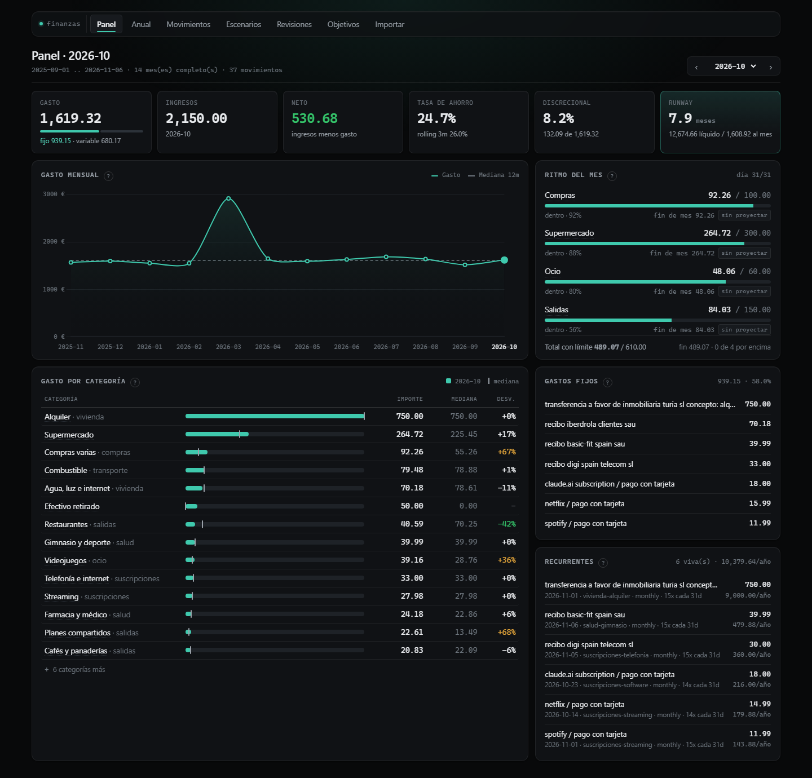
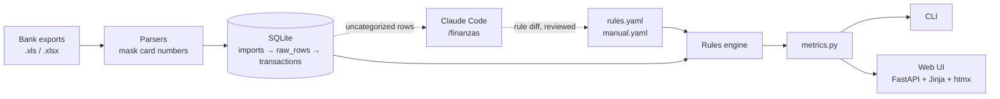
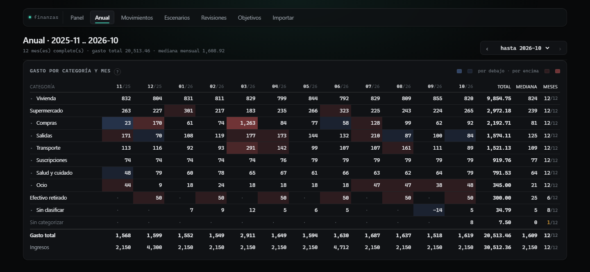
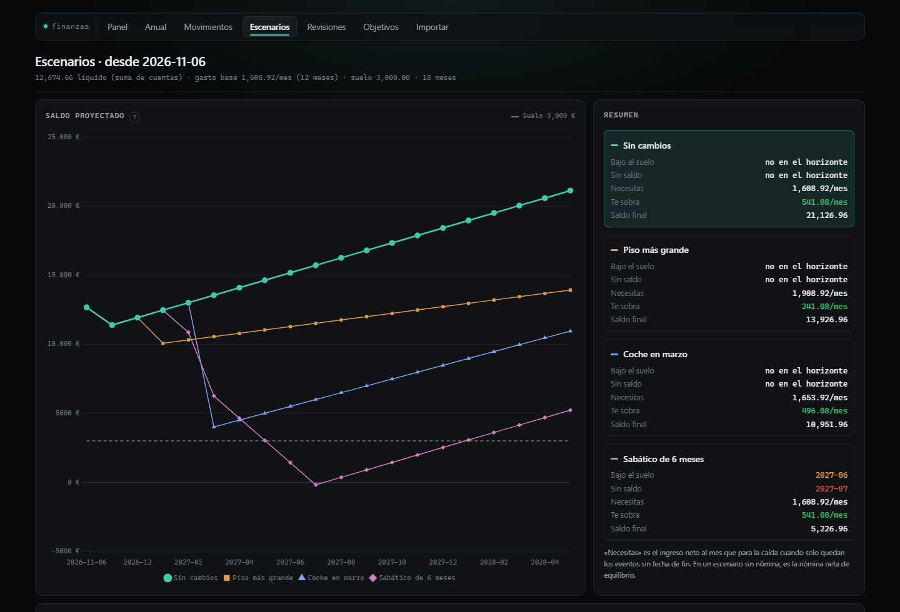
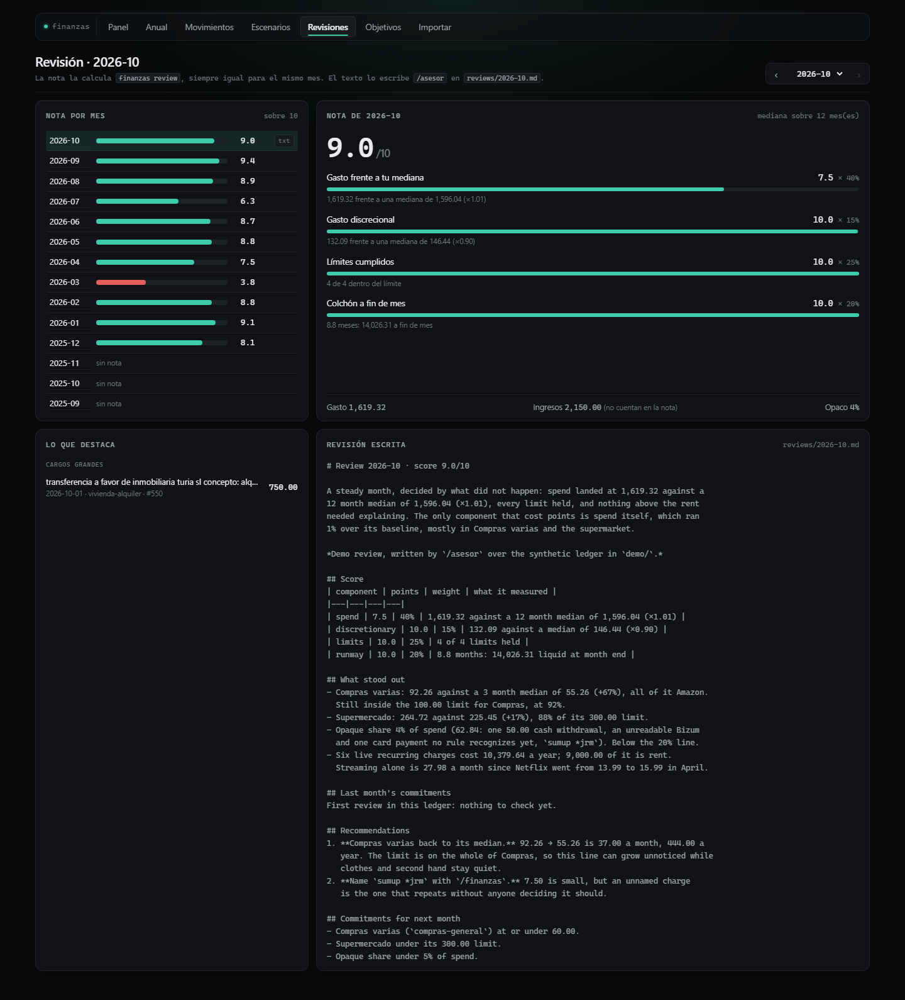

# finanzas

**A local-first personal finance ledger for Spanish bank exports.** It merges
overlapping Excel downloads from Santander and BBVA into one clean history,
categorizes every movement with rules you can read, and answers the questions
that matter: where the money went, how this month compares to your own normal,
what recurs, and how long your savings last if rent or income change.

The categorization rules are written by an LLM (Claude Code), reviewed as a
diff, and applied by the app. The app itself never calls a model, so the same
input always gives the same numbers.

[](https://github.com/Oppen-OC/finanzas/actions/workflows/tests.yml)




<sub>All data in this repository and in the screenshots is synthetic, generated by
[`demo/make_exports.py`](demo/make_exports.py).</sub>

## The problem

Spanish banks let you download your movements as Excel files, and that is all
they give you. In practice:

- **There are no transaction IDs.** Two coffees of 1.00 EUR on the same day are
  indistinguishable by date, amount and text, yet they are two real payments.
- **Downloads overlap.** You export "the last 3 months" whenever you remember,
  so every new file repeats part of the previous one.
- **The formats are hostile.** Legacy `.xls`, preambles of varying length,
  Bizum details hidden in a different column, and full card numbers in clear text.
- **The existing tools did not fit.** Open-source budgeting apps get smart
  categorization from add-ons that call an LLM API on every transaction, on a
  schedule. That means sending bank data to a third party, and the same movement
  can get a different category next month.

I wanted a ledger that runs on my own machine, never loses or double counts a
transaction, explains every category it assigns, and gives me numbers stable
enough to compare month over month.

## What it does

- **Imports** any number of overlapping exports, idempotently: re-importing a file
  is a no-op, and overlapping rows merge without loss or duplication.
- **Verifies** the ledger: the running balance chain must be continuous, both legs
  of every transfer between your own accounts must be present, and no card number
  may have reached the database.
- **Categorizes** with ordered regex rules in `rules.yaml` (first match wins), plus
  hand-pinned exceptions in `manual.yaml`. It reports dead and shadowed rules.
- **Measures**: spend against your own trailing median per category, fixed vs
  variable, savings rate, discretionary share, recurring charges and their annual
  cost, month-to-date pace against your limits, and runway.
- **Scores each month** out of 10, deterministically, and hands the facts to a
  Claude Code command that writes the review and tracks last month's commitments.
- **Projects** your balance month by month under what-if scenarios (new rent, a
  car, a gap in income) and tells you when each one drops below your floor.

Everything is available from a CLI and from a 7-page web UI.

## How it works



The solid path is the app: deterministic, offline, no model involved. The dotted
path is the monthly round in Claude Code, where the LLM looks only at what no rule
matched and proposes new rules for a human to accept. Its output is a file in git,
never a label written into the database.

## Engineering highlights

The full reasoning, with 31 numbered decisions, is in [docs/DESIGN.md](docs/DESIGN.md).
The parts worth a look:

- **Identity without IDs.** Both banks print a running balance, and in file order
  `balance[i] − amount[i] == balance[i+1]` holds for every row. The balance therefore
  goes into the dedupe key, so four identical Bizums on one day stay four rows, and a
  ledger-wide walk of the chain catches any missing period or double-counted row
  ([D2, D3, D11](docs/DESIGN.md#ingestion-and-identity)).
- **The LLM writes rules, not labels.** Reproducible, auditable, and the unmatched
  count trends to zero. The same split applies to the monthly review: `review.py`
  computes the score, Claude only writes the words around it
  ([D7, D29](docs/DESIGN.md#the-llm-half)).
- **Files are the source of truth; the database is disposable.** Delete
  `data/finanzas.db`, re-import, and you get the same ledger, categories and
  overrides back. That is why overrides, limits and scenarios live in YAML and not
  in tables ([D1, D15, D25](docs/DESIGN.md#configuration-as-files)).
- **Privacy by construction.** Card numbers and IBAN bodies are masked inside the
  parser, before anything is persisted, and `check` re-scans every stored column.
  The server binds to loopback only, and front-end libraries are vendored. A test
  fails if any rendered page loads anything over the network
  ([D6, D21](docs/DESIGN.md#front-end)).
- **Metrics that do not lie.** Only complete months count. Coverage is the
  intersection across accounts. Recurring charges are clustered by amount before
  their cadence is measured. Pace is computed as of the last imported day, not
  today ([D16, D17, D27](docs/DESIGN.md#metrics)).
- **Small on purpose.** About 3,400 lines of Python in flat modules, with no ORM,
  no service layer and no build step. Money is integer cents end to end.
- **Tests encode properties, not outputs.** 174 tests: category totals reconcile
  with the month's spend, internal transfers never reach either side of the ledger,
  recategorizing is idempotent, a manual override survives it, and nothing on a
  page is loaded from outside.

## Screenshots

**Anual**: category × month over the last 12 complete months. Each cell is coloured
against its own row's median, so habits, annual charges and one-offs look different.



**Escenarios**: balance projected month by month under each scenario in
`scenarios.yaml`, against a floor.



**Revisiones**: the deterministic monthly score with its components, next to the
review Claude wrote for that month.



## Try it

Requires [uv](https://docs.astral.sh/uv/). The demo generates 14 months of
synthetic exports and runs them through the real pipeline.

```bash
git clone https://github.com/Oppen-OC/finanzas.git
cd finanzas
uv sync
uv run python demo/make_exports.py      # synthetic exports into data/inbox/
uv run python -m finanzas update        # import, check, categorize
uv run python -m finanzas serve         # http://127.0.0.1:8000
```

Or with Docker: `docker compose up --build`, then open http://127.0.0.1:8000.

`update` ends by naming the two merchants no rule recognizes yet. That is the
hand-off point: in Claude Code, `/finanzas` proposes the rules for them.

### With your own exports

1. Put the last 4 digits of your IBAN (Santander) or card (BBVA) in `accounts.yaml`.
2. Drop the exports in `data/inbox/` (gitignored) and run `finanzas update`.
3. Extend `rules.yaml` for your merchants, by hand or with `/finanzas` in Claude
   Code. Adding another bank is one module in `finanzas/parsers/`.

## Commands

All of them run as `uv run python -m finanzas <command>`.

| Command | What it does |
|---|---|
| `update [paths]` | The monthly round: import, check, categorize, report what is left |
| `check` | Balance chain, internal transfer pairing, masking |
| `categorize [--dry-run] [--set ID CAT]` | Reapply the rules; pin one transaction by hand |
| `uncategorized` | What no rule matched, grouped by description, biggest first |
| `rules` | Per-rule match counts; names dead and shadowed rules |
| `report [--month]` | Every metric for one month |
| `year [--end YYYY-MM]` | Category × month spend over the last 12 complete months |
| `review [--month] [--json]` | The monthly score and its talking points |
| `project [--scenario ID]` | Balance month by month under each scenario |
| `goals [--set CAT EUR]` | Monthly limits per category |
| `list`, `stats`, `export`, `backup`, `serve` | The rest |

## Claude Code integration

The repository ships the commands that run the LLM half:

- [`/finanzas`](.claude/commands/finanzas.md): the monthly round. It imports, stops
  on any integrity problem, researches unknown merchants, proposes new rules as a
  diff for approval, and verifies them.
- [`/asesor`](.claude/commands/asesor.md): the monthly review. It copies the score,
  asks about what the data cannot explain, and writes `reviews/YYYY-MM.md` with
  commitments the next review checks. [Example](reviews/2026-10.md).
- [`categorizar`](.claude/skills/categorizar/SKILL.md): the skill holding the rules
  for writing rules.

## Project layout

```
finanzas/
  parsers/        one module per bank: detect() and parse()
  clean.py        masking, money, dates, text normalization
  ingest.py       additive, idempotent import
  check.py        balance chain, transfer pairing, leak scan
  rules.py        the categorization engine
  metrics.py      every number the CLI and the UI show
  review.py       the monthly score
  projection.py   scenario arithmetic
  web/            FastAPI app, Jinja templates, vendored Chart.js and htmx
tests/            unittest, no fixtures framework
demo/             synthetic export generator
docs/DESIGN.md    constraints and design decisions
*.yaml            categories, rules, overrides, limits, scenarios, accounts
```

## Tests

```bash
uv run python demo/make_exports.py   # the ingestion tests read an export from data/inbox
uv run python -m unittest
```
